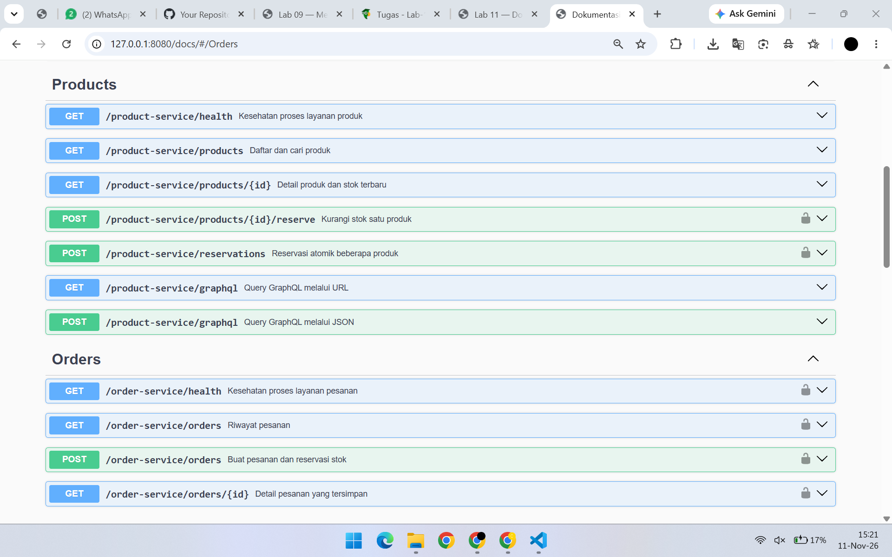
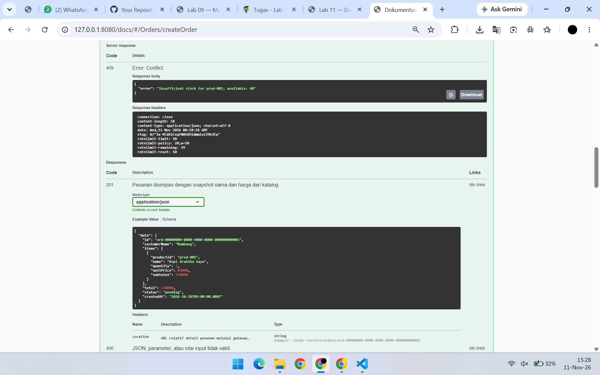
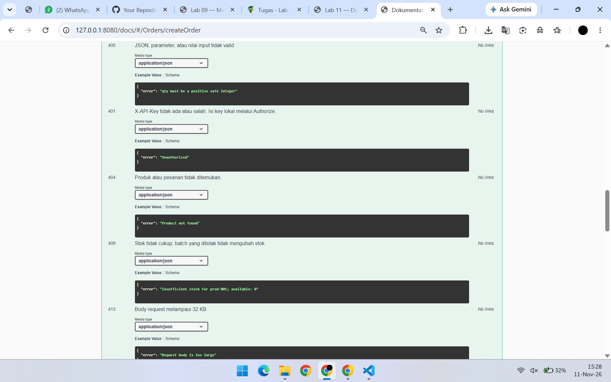
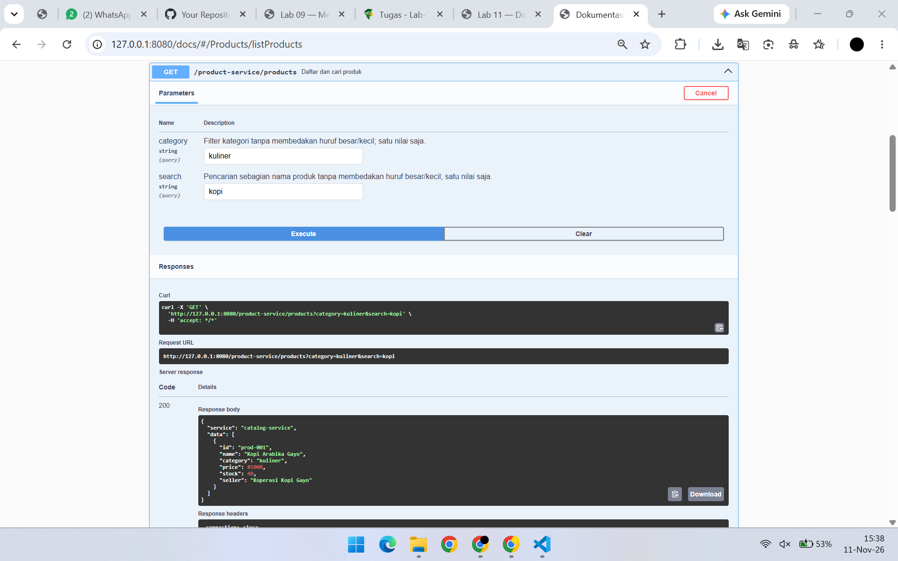
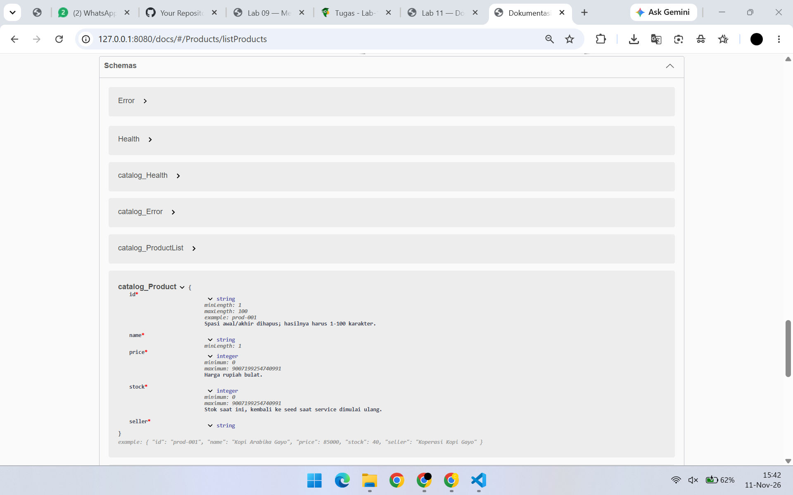
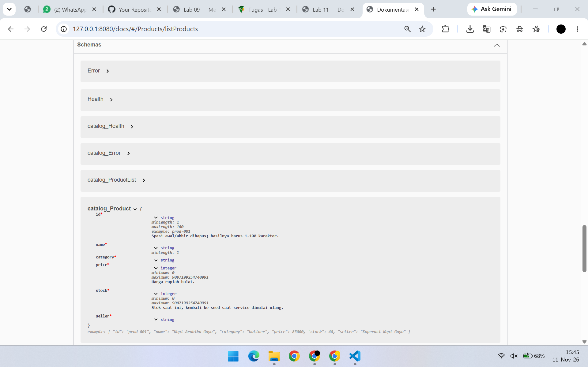
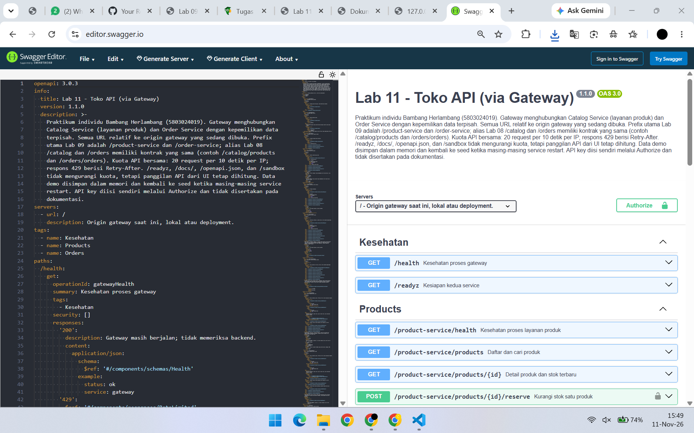
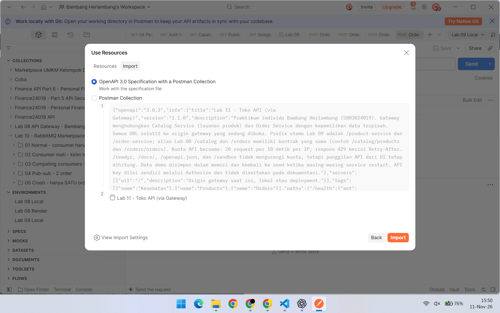
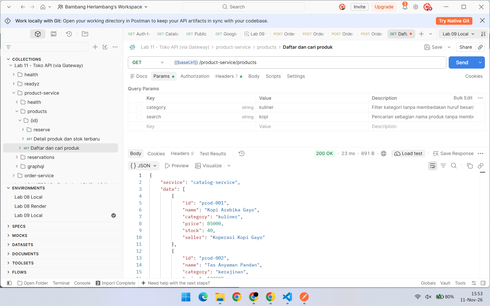

# Bukti manual Lab 11

Screenshot diambil pengguna pada **11 November 2026** melalui browser dan aplikasi Postman. Seluruh gambar merupakan PNG asli yang disalin tanpa crop, perubahan isi, atau penyuntingan piksel. Nama file dirapikan agar sesuai urutan tugas. [Manifest](verification.json) mencatat nama sumber, SHA-256, ukuran, waktu file sumber dalam UTC, dan status verifikasi.

## Daftar bukti

| No. | Bukti | Screenshot asal | Hasil yang terlihat |
| --- | --- | --- | --- |
| 1 | [Gateway dua grup](01-swagger-groups.png) | Screenshot (1964).png | Products dan Orders beserta prefix endpoint |
| 2a | [Respons 409](02-swagger-409-response.png) | Screenshot (1973).png | Server response 409 Conflict; stok tersedia 40 |
| 2b | [Dokumentasi 409](02-swagger-409-documentation.png) | Screenshot (1974).png | Status 409 didokumentasikan sebagai stok tidak cukup |
| 3a | [Respons saat drift](03-drift-before-response.png) | Screenshot (1978).png | GET 200 memuat category: kuliner |
| 3b | [Skema sebelum perbaikan](03-drift-before-schema.png) | Screenshot (1983).png | catalog_Product belum memuat category |
| 4 | [Skema sesudah perbaikan](04-drift-after-schema.png) | Screenshot (1984).png | category bertipe string kembali muncul di skema dan contoh |
| 5 | [Swagger Editor](05-swagger-editor.png) | Screenshot (1985).png | Spesifikasi Lab 11 dimuat dan dirender; tidak terlihat panel error |
| 6a | [Dialog impor OpenAPI](06-postman-import.png) | Screenshot (1986).png | Postman mengenali OpenAPI 3.0 dan koleksi Lab 11 |
| 6b | [Postman 200 OK](07-postman-200.png) | Screenshot (1990).png | Request dari koleksi hasil impor menghasilkan daftar produk |

## 1. Dokumentasi gabungan gateway

Alamat gateway `127.0.0.1:8080/docs/` menampilkan grup Products dan Orders. Prefix `/product-service` dan `/order-service` menunjukkan kedua service digabung melalui gateway.

## 2. Respons aktual 409 dan kontraknya

Pengguna mengirim POST `/order-service/orders` dengan quantity 100 untuk prod-001 melalui Try it out setelah melakukan Authorize. Respons aktual menyatakan 409 Conflict karena stok tersedia 40. Gambar ini tidak menampilkan bagian Curl yang memuat key.

Bagian dokumentasi di bawah menunjukkan bahwa 409 telah dicantumkan pada kontrak endpoint. Nilai `available: 0` di Example Value merupakan contoh dokumentasi; respons aktual di atas bernilai 40.

## 3. Drift sebelum diperbaiki

Anotasi category dihapus sementara dari required, properties, dan example skema Product, sementara data produk tetap memiliki category. Setelah restart, respons nyata GET produk masih memuat `category: kuliner`.

Pada saat yang sama, skema catalog_Product hanya memuat id, name, price, stock, dan seller. Perbedaan dengan respons di atas membuktikan drift pada skema. Contoh respons yang ditulis terpisah di endpoint masih dapat memuat category; karena itu pembandingan berfokus pada skema Product, bukan mengklaim seluruh contoh endpoint sudah menghilangkan category.

## 4. Setelah anotasi diperbaiki

Pengguna mengembalikan ketiga bagian anotasi, menyimpan file, me-restart aplikasi, dan me-refresh Swagger. Field category bertipe string serta contoh category kembali tampil. Kode akhir telah diperiksa dan tidak ditinggalkan dalam kondisi drift.

## 5. Impor ke Swagger Editor

Swagger Editor memuat spesifikasi OpenAPI 3.0.3 dengan judul Lab 11 dan merender endpointnya. Tidak terlihat panel error pada screenshot. Validasi menyeluruh spesifikasi dilakukan terpisah menggunakan Swagger Parser lokal.

## 6. Impor OpenAPI ke Postman dan request aktual

File yang diimpor adalah openapi.json ekspor gateway, dengan opsi OpenAPI 3.0 Specification with a Postman Collection.

Setelah impor selesai, request Daftar dan cari produk dijalankan dari koleksi Lab 11. baseUrl bernilai `http://127.0.0.1:8080`; filter category dan search dinonaktifkan. Hasil aktual adalah 200 OK dan JSON daftar produk.

## Cakupan bukti

Seluruh screenshot di atas merupakan eksekusi lokal. Status 201, 404, 400, dan 503 tetap didukung [rekaman demo otomatis](../results.json), bukan diklaim sebagai screenshot manual tambahan. Stok 40 pada sesi manual dan stok 38 pada demo otomatis berasal dari sesi berbeda. File asli yang menampilkan API key tidak disalin ke paket pengumpulan.
