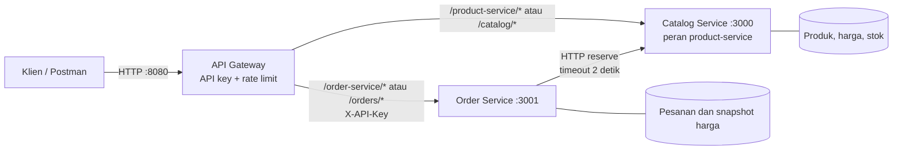

# Praktikum Web Service Sesi 09: Memecah Aplikasi Menjadi Microservices

Nama: **Bambang Herlambang**

NRP: **5803024019**

Pengerjaan: **Individu**, mengikuti arahan pengerjaan terbaru

Repository: [prakwebservice-lab09-microservices](https://github.com/academicbambang/prakwebservice-lab09-microservices), repository Git terpisah khusus Lab 09
Sumber gateway yang dipakai ulang: [prakwebservice-lab08-api-gateway](https://github.com/academicbambang/prakwebservice-lab08-api-gateway)

Implementasi, laporan, diagram, collection Postman, dan bukti pengujian disusun dalam repository khusus Lab 09 tersebut.

## Tujuan dan penyesuaian dari materi

Praktikum ini memindahkan pengelolaan stok dari handler pesanan monolit ke layanan produk yang dihubungi lewat HTTP, lalu membuktikan bahwa riwayat pesanan tetap dapat dibaca ketika layanan produk berhenti. Pengerjaan menggunakan repository terpisah untuk Lab 09, memakai ulang gateway Lab 08, dan menerapkan contoh produk Marketplace UMKM Kelompok D. Nama folder `catalog-service` dipertahankan dari kode sumber sebagai implementasi **product-service**; service ini menjadi satu-satunya pemilik produk, harga, dan stok. Dengan demikian, dua service bisnis tetap `catalog-service` dan `order-service`, sedangkan `gateway` menyediakan pintu masuk bersama.

Contoh materi memakai ID angka dan body `{productId, qty}`. Repository ini mempertahankan ID `prod-001` dan body pesanan Lab 08 berupa `customerName` serta `items`, sehingga fitur lama tetap dapat dipakai. Body endpoint reservasi satu produk tetap `{ "qty": 2 }`. Untuk pesanan dengan beberapa produk, endpoint reservasi batch memeriksa semua produk sebelum mengurangi stok agar penolakan satu item tidak menyebabkan pemotongan sebagian.

## Sebelum dan sesudah

Versi [monolit](../../monolith/README.md) menyimpan produk dan pesanan di satu proses; handler `POST /orders` langsung mengurangi `product.stock`. Pada versi microservices, Order Service tidak mengimpor array produk, membaca file data katalog, atau mengubah stok secara langsung. Order Service meminta reservasi lewat HTTP, menerima salinan produk dari katalog, lalu menyimpan salinan nama dan harga pada pesanan.



Diagram terpisah tersedia sebagai [PNG](arsitektur.png), [SVG](arsitektur.svg), dan [sumber Mermaid](arsitektur.mmd).

## Pemetaan ke proyek Marketplace UMKM

| Service | Data yang dimiliki | API yang ditawarkan | Contoh panggilan antarservice |
| --- | --- | --- | --- |
| Catalog / Product Service | Produk, kategori, penjual, harga, stok tersedia | `GET /products`, `GET /products/:id`, `POST /products/:id/reserve`, `POST /reservations`, GraphQL katalog | Order Service memanggil reservasi saat membuat pesanan; hanya katalog yang boleh mengurangi stok |
| Order Service | ID pesanan, pelanggan, jumlah barang, salinan nama/harga, total, waktu, status pesanan | `GET /orders`, `GET /orders/:id`, `POST /orders` | Saat membutuhkan nama, harga, dan pemotongan stok, Order Service memanggil Catalog Service melalui HTTP |
| API Gateway | Konfigurasi routing, API key, penghitung rate limit; tidak memiliki data bisnis | Prefix `/product-service/*` dan `/order-service/*`; alias Lab 08 `/catalog/*` dan `/orders/*` | Meneruskan request klien ke service terkait setelah menerapkan pemeriksaan gateway |

Order menyimpan **snapshot** nama dan harga ketika transaksi dibuat. Perubahan produk berikutnya tidak boleh mengubah rincian pesanan yang telah tersimpan. Seluruh data bisnis praktikum ini masih berada dalam memori, bukan database persisten.

## Menjalankan dan membandingkan

Gunakan Node.js 22 atau lebih baru. Jalankan seluruh perintah berikut dari root repository.

```sh
npm install
npm run setup
node monolith/monolith.js
```

Uji monolit sesuai [petunjuknya](../../monolith/README.md), lalu hentikan monolit dengan `Ctrl+C`. Jalankan versi microservices:

```sh
npm start
```

Default lokal: katalog `127.0.0.1:3000`, pesanan `127.0.0.1:3001`, gateway `127.0.0.1:8080`. Ketika perlu mematikan **hanya katalog**, jalankan ketiga proses di terminal terpisah sebagai berikut, karena launcher `npm start` menghentikan seluruh stack ketika salah satu child keluar:

```sh
node catalog-service/server.js
```

```sh
node order-service/server.js
```

```sh
node gateway/gateway.js
```

Ambil nilai `API_KEY` dari `gateway/.env` hanya untuk variabel lokal `apiKey` di Postman. Jangan menyalin key ke laporan, screenshot, atau berkas yang akan di-commit. Import [collection Lab 09](../postman/lab09.postman_collection.json) dan [environment lokal Lab 09](../postman/lab09.postman_environment.json). Semua request klien menggunakan `{{baseUrl}}` dengan default `http://127.0.0.1:8080`.

| Request melalui gateway | Fungsi | Status normal |
| --- | --- | --- |
| `GET /product-service/products` | Daftar produk | `200` |
| `GET /product-service/products/prod-001` | Stok dan detail produk | `200` |
| `POST /order-service/orders` | Membuat pesanan setelah reservasi stok | `201` |
| `GET /order-service/orders` | Daftar pesanan dari memori Order Service | `200` |
| `POST /product-service/products/prod-001/reserve` | Reservasi langsung untuk demonstrasi | `200` |

Jalur pesanan dan reservasi melalui gateway memerlukan `X-API-Key`. Operasi baca katalog tetap dapat diakses tanpa key. Body pembuatan pesanan:

```json
{
  "customerName": "Bambang",
  "items": [{ "productId": "prod-001", "quantity": 2 }]
}
```

Dengan data awal, harga kopi `85000`, stok `40`, dan jumlah `2`, pesanan bernilai `170000` serta stok menjadi `38`. Nilai `unitPrice`, `subtotal`, atau `total` dari klien tidak menjadi sumber harga.

## Smoke test dan uji kegagalan

Untuk menguji stack yang sudah berjalan:

```sh
npm run test:smoke
```

Smoke test membuat satu pesanan sehingga stok benar-benar berkurang. Ulangi pengujian dengan memperhatikan sisa stok, atau mulai ulang katalog untuk mengembalikan fixture awal. Untuk pengujian otomatis terisolasi beserta pencatatan bukti lokal:

```sh
npm test
npm run test:lab09
```

`test:lab09` menjalankan proses service lokal pada port pengujian, melakukan smoke test, menghentikan hanya katalog, menguji pesanan, kemudian menghidupkan kembali katalog. Seluruh skenario dan pencatatan bukti berlangsung pada komputer lokal.

Untuk mengulangi bukti kegagalan secara manual di Postman:

1. Mulai ketiga service di terminal terpisah dan buat satu pesanan sukses. Simpan ID pesanan itu.
2. Hentikan **hanya** `catalog-service` dengan `Ctrl+C` pada terminalnya. Jangan menghentikan Order Service atau gateway.
3. Kirim `POST /order-service/orders` dengan body valid dan key yang benar. Harapannya `503` dengan pesan layanan produk tidak tersedia; tidak ada pesanan baru yang tersimpan.
4. Kirim `GET /order-service/orders`. Harapannya `200` dan pesanan sukses sebelumnya tetap ada.
5. Jalankan kembali `node catalog-service/server.js`, lalu ulangi `POST /order-service/orders`. Harapannya `201`.
6. Cek stok katalog: proses katalog baru memulai data dari stok awal. Pesanan lama tetap ada selama proses Order Service yang sama masih berjalan.

Ambil screenshot **POST 503, GET 200 saat katalog mati, dan POST 201 setelah pulih**, serta output smoke test. Tampilkan method, URL, status, dan body; sembunyikan nilai key. Collection menyediakan tiga kelompok berurutan: alur normal, input negatif, dan kegagalan/pemulihan. Kelompok kegagalan dijalankan manual dengan berhenti di antara request untuk mematikan atau menghidupkan katalog; jangan menjalankan seluruh collection tanpa intervensi ini. Gateway membatasi 20 request per 10 detik per IP; tunggu window berikutnya bila memperoleh `429`.

## Skenario dan bukti yang dikumpulkan

| Skenario | Hasil yang harus diperiksa |
| --- | --- |
| Smoke test melalui gateway | Tiga produk, pesanan `201`, stok turun sebanyak jumlah yang dipesan |
| Quantity nol atau pecahan | `400`, stok dan daftar pesanan tidak berubah |
| Produk tidak dikenal | `404`, pesanan tidak dibuat |
| Stok tidak cukup | `409`, stok tidak menjadi negatif dan pesanan tidak dibuat |
| Reservasi beberapa produk ditolak | Seluruh stok tetap sama; tidak ada pemotongan sebagian |
| Pesanan bersamaan melebihi stok | Pesanan yang diterima hanya sebanyak stok tersedia |
| Katalog berhenti | POST pesanan `503`; GET pesanan tetap `200` |
| Katalog lambat | Request reservasi dibatasi 2 detik dan dikembalikan sebagai `503` |
| Katalog hidup kembali | POST pesanan `201`; stok katalog mulai dari fixture awal |

## Hasil eksekusi lokal

Suite `npm test` memeriksa reservasi stok, penolakan batch tanpa pengurangan sebagian, pesanan bersamaan, timeout, serta perilaku gateway. Jumlah test dan status eksekusi terbaru pada repository ini tersedia pada [log pengujian otomatis](../evidence/lab09/tests.txt).

Timestamp dan rekaman demo tiga proses lokal tersedia pada [JSON smoke test](../evidence/lab09/smoke-test.json) serta [JSON kegagalan service](../evidence/lab09/service-failure.json). Skrip memilih port lokal yang tersedia secara otomatis agar tidak mengganggu stack lain. Ringkasan hasil yang disertakan dalam bukti:

| Pengujian | Hasil aktual | Screenshot |
| --- | --- | --- |
| Smoke test melalui gateway | 3 produk; POST pesanan `201`; stok kopi `40 → 38`; total `170000` | [Output smoke test](../evidence/lab09/smoke-test.png) |
| POST pesanan saat katalog berhenti | `503`; Order Service dan gateway tetap berjalan | [POST saat katalog mati](../evidence/lab09/product-down-post.png) |
| GET pesanan saat katalog masih berhenti | `200`; pesanan dari smoke test tetap dapat dibaca | [GET saat katalog mati](../evidence/lab09/product-down-get.png) |
| POST setelah katalog hidup kembali | `201`; stok katalog dimulai kembali dari `40` | [POST setelah pulih](../evidence/lab09/product-recovered-post.png) |

Verifikasi akhir memastikan dua pesanan tersimpan di Order Service: pesanan sebelum gangguan dan pesanan setelah katalog pulih. POST yang gagal ketika katalog berhenti tidak membuat pesanan baru. Stok kopi setelah pesanan pemulihan adalah `38`.

Sumber bukti:

- [Halaman hasil pengujian](../evidence/lab09/index.html) dan [asal bukti serta cara regenerasi](../evidence/lab09/README.md).
- [Log smoke test](../evidence/lab09/smoke-test.txt) dan [data JSON smoke test](../evidence/lab09/smoke-test.json).
- [Log uji kegagalan](../evidence/lab09/service-failure.txt) dan [data JSON uji kegagalan](../evidence/lab09/service-failure.json).
- [Diagram PNG](arsitektur.png), [SVG](arsitektur.svg), dan [Mermaid](arsitektur.mmd).

Keempat screenshot di atas adalah tangkapan browser atas halaman hasil otomatis yang menampilkan request dan respons HTTP aktual. Screenshot tersebut berasal dari eksekusi Node.js melalui gateway lokal; **bukan screenshot Postman**. Collection Postman disediakan untuk mengulangi skenario secara manual. Header API key tidak disimpan dalam bukti. Laporan dan bukti dalam repository ini khusus untuk Lab 09; atribusi Lab 08 merujuk pada kode gateway yang dipakai ulang.

## Batasan konsistensi dan data

Pemeriksaan dan pengurangan stok dilakukan secara sinkron dalam satu handler katalog tanpa jeda `await` di antara validasi dan mutasi. Ini mencegah overselling di **satu proses katalog** untuk demo in-memory, termasuk penggabungan produk yang muncul beberapa kali dalam satu pesanan. Reservasi batch hanya menjamin seluruh pengurangan pada katalog; ia belum menjadi transaksi atomik yang mencakup penyimpanan pesanan pada service lain.

Jika stok sudah berkurang lalu Order Service gagal menyimpan pesanan, atau respons reservasi hilang/terlambat, stok dapat tetap terpotong tanpa pesanan yang berhasil dilihat klien. Timeout juga tidak membuktikan bahwa katalog belum memproses request. Implementasi praktikum ini belum memiliki idempotency key, rollback terdistribusi, pembayaran, penyimpanan persisten, atau koordinasi transaksi lintasservice. Pengembangan proyek dapat memakai reservasi dengan masa berlaku, operasi kompensasi, dan penyimpanan transaksional sesuai kebutuhan.

## Refleksi

Ketika Catalog Service mati, Order Service masih dapat menampilkan pesanan karena riwayat pesanan dimiliki dan dibaca dari memorinya sendiri. Hal ini memungkinkan pengguna memeriksa transaksi yang sudah tersimpan sambil menunggu katalog pulih. Jika stok telah dikurangi oleh reservasi tetapi pembuatan pesanan gagal sesudahnya, stok dan pesanan dapat menjadi tidak konsisten sehingga perlu mekanisme kompensasi atau reservasi dengan masa berlaku. Dibanding monolit, microservices menambah panggilan jaringan, timeout, kemungkinan kegagalan sebagian, serta pekerjaan konfigurasi dan pengujian. Pemisahan tanggung jawab membantu membatasi dampak gangguan, tetapi manfaat itu harus dibayar dengan pengelolaan konsistensi dan operasi yang lebih rumit.

## Pengumpulan

Materi Lab 09 meminta tautan satu repository, output smoke test, tiga screenshot uji kegagalan, diagram arsitektur, pemetaan service proyek, dan refleksi sebelum Lab 10. Tautan pengumpulan menggunakan [repository khusus Lab 09](https://github.com/academicbambang/prakwebservice-lab09-microservices), dengan petunjuk menjalankan aplikasi dan lokasi bukti dijelaskan dalam README.
