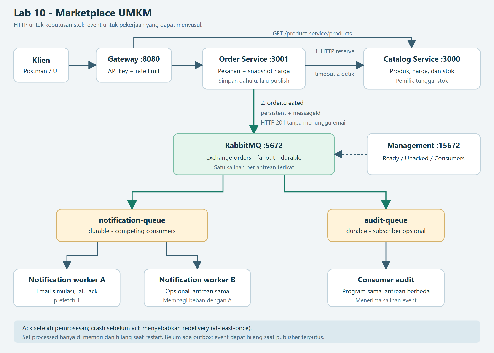

# Lab 10 - Komunikasi Antarservice via Message Queue

Nama: **Bambang Herlambang** · NRP **5803024019**

Proyek: **Marketplace UMKM (Kelompok D)**. Panduan Lab 10 menetapkan praktikum berkelompok; identitas di atas adalah pemilik repository, bukan pernyataan bahwa dosen mengubah format tugas menjadi individu. Anggota lain tidak dicantumkan karena datanya belum diberikan.

Repository: [prakwebservice-lab09-microservices](https://github.com/academicbambang/prakwebservice-lab09-microservices). Lab 10 dikembangkan di repository Lab 09 yang sama; tidak membuat repository baru. Folder dan bukti Lab 09 tetap tersedia.

Tautan pengumpulan versi Lab 10: [lab10-message-queue](https://github.com/academicbambang/prakwebservice-lab09-microservices/tree/lab10-message-queue).

## Tujuan dan hasil

Order Service mereservasi stok secara sinkron kepada Catalog Service, menyimpan pesanan, menerbitkan event `order.created`, lalu mengembalikan HTTP `201` tanpa menunggu notifikasi. RabbitMQ menyalurkan event melalui exchange fanout `orders` ke antrean durable `notification-queue`; Notification Service melakukan simulasi pengiriman email, kemudian memberikan acknowledgement manual. Email pada praktikum ini adalah log simulasi, bukan email nyata ke pelanggan.

Pengujian menggunakan RabbitMQ Docker asli, gateway, katalog, order, dan consumer sebagai proses Node.js terpisah. [Rekaman JSON](../evidence/lab10/results.json) menyimpan status HTTP, statistik antrean, messageId, identitas consumer, flag redelivered, serta timestamp aktual. [Bukti dan cara regenerasi](../evidence/lab10/README.md) menjelaskan asal screenshot.

## Arsitektur dan batas data



Sumber diagram: [Mermaid](arsitektur.mmd) dan [SVG](arsitektur.svg).

| Komponen | Data/tanggung jawab | Komunikasi |
| --- | --- | --- |
| Gateway :8080 | Routing, API key, rate limit | HTTP ke katalog/pesanan |
| Catalog Service :3000 | Produk, harga, stok di memori | HTTP reserve; satu-satunya pengubah stok |
| Order Service :3001 | Pesanan dan snapshot harga di memori | HTTP reserve sebelum membuat order; producer event setelah order disimpan |
| RabbitMQ :5672 | Exchange `orders` fanout; antrean durable; pesan persistent | AMQP; dashboard lokal :15672 |
| Notification Service | Simulasi email; Set messageId yang diproses selama proses hidup | Consumer `notification-queue`, manual ack, prefetch 1 |
| Consumer audit (opsional) | Simulasi salinan untuk audit; belum penyimpanan audit permanen | Program consumer yang sama, argumen `audit-queue` |

HTTP reservasi stok tetap memakai timeout 2 detik dan penanganan error Lab 09. Tidak ada akses langsung ke data katalog dari Order Service. Pemisahan ini memastikan order tidak dibuat jika stok tidak dapat dipastikan, tetapi kelambatan email tidak menahan checkout.

## Menjalankan dari awal

Prasyarat: Node.js 22+, npm, Docker Desktop dengan Linux engine aktif. Jalankan seluruh perintah dari root repository. Port default: `3000`, `3001`, `8080`, `5672`, dan `15672`.

```sh
npm ci
npm run setup
npm run broker:up
```

Compose menjalankan `rabbitmq:3-management`, health check, hostname tetap, volume data, dan port yang hanya diekspos ke loopback. Dashboard: [RabbitMQ Management lokal](http://127.0.0.1:15672), menggunakan akun demo bawaan `guest` / `guest` seperti panduan. Ini akun default lokal, bukan kredensial cloud. Jangan pakai akun default untuk layanan publik. `docker compose stop` dan `down` mempertahankan named volume; jangan menggunakan `down -v` jika data broker masih diperlukan.

Terminal 1 - consumer **dibuat terlebih dahulu**, agar queue sudah terikat sebelum event pertama:

```sh
npm run start:notification
```

Terminal 2 - tiga service HTTP (katalog, pesanan, gateway):

```sh
npm start
```

Tunggu log publisher `"kind":"ready"` / `Terhubung ke RabbitMQ`. Terminal 3:

```sh
npm run test:smoke
```

Hasil: HTTP `201`, stok berkurang, lalu terminal consumer menampilkan `email terkirim (simulasi)` setelah jeda sekitar 1 detik. Smoke test Lab 09 memakai quantity 2; demo otomatis Lab 10 memakai quantity 1 agar cukup untuk seluruh skenario.

API key diambil secara lokal dari `gateway/.env`, lalu dipakai sebagai header `X-API-Key`. File `.env` diabaikan Git. Alternatif pengujian adalah [collection Postman Lab 10](../postman/lab10.postman_collection.json), memakai [environment lokal Lab 09](../postman/lab09.postman_environment.json). Isi `apiKey` sendiri; jangan menaruhnya di laporan atau screenshot.

Untuk broker cloud, atur `AMQP_URL` di environment atau `gateway/.env` untuk **order dan consumer**, misalnya `amqps://...` dengan kredensial dari penyedia. Jangan commit URL asli. Consumer memuat file lokal yang sama dengan Order Service. URL/key tidak dicetak ke log. `ORDER_EXCHANGE` opsional (default `orders`); `NOTIFICATION_QUEUE` default `notification-queue`; `CONSUMER_NAME` membedakan worker; `NOTIFICATION_DELAY_MS` default `1000`.

## Eksperimen manual sesuai langkah 04-07

### 1. Alur normal

Dengan broker dan semua service aktif, jalankan smoke test atau kirim `POST /order-service/orders` melalui gateway:

```json
{
  "customerName": "Bambang Lab 10",
  "items": [{ "productId": "prod-001", "quantity": 1 }]
}
```

Body mengikuti API Marketplace UMKM dari Lab 09, bukan contoh `{productId:1,qty:2}`. Consumer membaca `event.data.items` sehingga nama dan jumlah produk selalu sesuai payload aktual. Periksa HTTP `201` dan log `email` lalu `acked` dengan orderId yang sama. Respons tidak menunggu consumer.

### 2. Consumer mati dan pulih

1. Pastikan consumer sudah pernah menampilkan log `ready` agar queue durable terbuat dan terikat.
2. Hentikan **hanya consumer** dengan Ctrl+C; biarkan gateway, katalog, order, dan broker hidup.
3. Kirim tepat tiga order quantity 1. Semua harus `201`.
4. Buka dashboard, pilih virtual host `/`, tab **Queues and Streams**, lalu `notification-queue`. Tunggu pembaruan statistik: **Ready=3, Unacked=0, Consumers=0**. Ambil screenshot.
5. Jalankan lagi `npm run start:notification`. Tiga event diproses; setelah ack seluruhnya, Ready dan Unacked menjadi 0. Simpan log consumer.

Consumer tidak perlu aktif saat order dibuat; broker harus aktif dan antrean/binding harus sudah ada. Exchange fanout tidak menyimpan pesan sendiri. Tanpa antrean terikat, event tidak dapat ditahan; publisher mencatat `unroutable`.

### 3. Competing consumers

Mulai dengan antrean kosong. Buka dua terminal:

```sh
node notification-service/notification-service.js
```

Jalankan perintah yang sama di terminal kedua, lalu kirim enam order. Dua consumer pada **antrean yang sama** membagi enam pesan; setiap pesan diberikan kepada satu consumer pada satu waktu. `prefetch(1)` membatasi satu pesan unacked per worker. Hasil demo aktual menunjukkan pembagian 3 dan 3; pembagian persis seimbang tidak dijamin untuk worker dengan waktu pemrosesan berbeda. Pada kegagalan sebelum ack, pesan bisa dikirim ulang sehingga pola ini tetap at-least-once.

### 4. Publish/subscribe

Hentikan salah satu worker tadi; jalankan:

```sh
node notification-service/notification-service.js audit-queue
```

Kedua antrean tetap terikat ke exchange `orders`. Kirim dua order. **Setiap antrean** menerima salinan kedua event: notification consumer memproses 2, audit consumer juga 2. Audit memakai program dan log email simulasi yang sama agar fanout mudah diamati; ini bukan implementasi database audit produksi. Berbeda dengan competing consumers, antrean berbeda tidak saling membagi satu salinan.

### 5. Crash sebelum ack dan redelivery

Pastikan `notification-queue` kosong dan hentikan semua consumer yang membaca antrean itu. Jalankan:

```sh
node notification-service/notification-service.js --crash
```

Kirim satu order. Consumer mencetak email lalu `Crash sebelum ack!` dan keluar dengan kode 1. Broker belum menerima ack; pesan kembali Ready setelah koneksi consumer terputus. Jalankan consumer biasa:

```sh
npm run start:notification
```

Email tercetak lagi untuk **messageId dan orderId yang sama**, sekarang dengan `redelivered=true`; setelah ack antrean kosong. Set `processed` hilang saat proses crash. Jika event dengan messageId yang sama dikirim dua kali selama proses consumer yang sama masih hidup, salinan kedua dilewati dan di-ack. Deduplikasi dalam memori ini sengaja dipertahankan agar kelemahannya terlihat sesuai panduan.

## Format event dan perilaku publisher

Payload event:

```json
{
  "type": "order.created",
  "data": {
    "id": "ord-<uuid>",
    "customerName": "Bambang Lab 10",
    "items": [{
      "productId": "prod-001",
      "name": "Kopi Arabika Gayo",
      "quantity": 1,
      "unitPrice": 85000,
      "subtotal": 85000
    }],
    "total": 85000,
    "status": "pending",
    "createdAt": "<timestamp ISO 8601>"
  }
}
```

AMQP properties: `messageId = order-${order.id}`, `type=order.created`, `contentType=application/json`, `persistent=true`. Exchange dan queue memakai `durable=true`. MessageId stabil dipakai untuk mendeteksi event yang sama; `redelivered` berasal dari broker, bukan tanda bahwa side effect pasti sudah atau belum terjadi.

Publisher menggunakan confirm channel dengan callback asinkron dan `mandatory=true`. Log `published` berarti dikirim ke buffer; `confirmed` berarti broker mengonfirmasi publikasi, **bukan** consumer sudah mengirim email. Event tanpa antrean tujuan menghasilkan `unroutable` walaupun broker mengonfirmasi publikasinya. Nilai `false` dari `channel.publish` berarti buffer menahan backpressure; pesan saat itu sudah dibuffer, bukan ditolak. Publisher membatasi pending confirms dan menolak publikasi baru sementara buffer/broker blocked untuk menghindari buffer tak terbatas; kondisi ini dicatat sebagai event tidak terkirim.

Jika RabbitMQ belum tersedia atau koneksi/channel putus, publisher mencoba terhubung kembali setiap 3 detik tanpa mematikan HTTP Order Service. Order yang sudah disimpan tetap `201`, tetapi event yang tidak terkirim **tidak direplay otomatis**. Tidak ada transaksi antara Map pesanan dan RabbitMQ. Durable queue, persistent message, dan publisher confirm tidak menutup celah kegagalan sebelum publikasi; at-least-once di sini menjelaskan redelivery pesan yang sudah diterima/diantrekan broker, bukan jaminan semua order pasti menghasilkan event.

Consumer memakai manual ack setelah simulasi email; JSON/event/messageId tidak valid di-nack dengan `requeue=false` agar tidak menjadi poison-message loop. Belum ada dead-letter queue. Consumer keluar jika koneksi broker putus dan perlu dijalankan ulang; publisher reconnect otomatis. Simulator tidak memakai SMTP, database persisten, atau transactional outbox.

## Bukti manual utama untuk pengumpulan

Pengguna mengulangi skenario melalui Postman, dashboard RabbitMQ, dan terminal VS Code pada **4 November 2026**, menggunakan **virtual host `/`** dan gateway `http://127.0.0.1:8080`. Screenshot asli disimpan utuh pada [folder bukti manual](../evidence/lab10/manual/README.md) dan dipakai dalam PDF sebagai bukti utama butir (2) dan (3).

| Butir | Hasil yang terlihat | Bukti manual |
| --- | --- | --- |
| (2) Consumer mati | Tiga order mendapat `201`; dashboard menunjukkan Ready=3, Unacked=0, Consumers=0 | [Dashboard](../evidence/lab10/manual/dashboard-ready-3.png) |
| (2) Consumer pulih | Consumer-18824 memproses ketiga order yang sama, masing-masing mencetak email simulasi dan ack | [Terminal pemulihan](../evidence/lab10/manual/consumer-recovered.png) |
| (3) Crash sebelum ack | Consumer-5556 mencetak email lalu crash; consumer-18608 mencetak email lagi untuk messageId sama dengan `redelivered:true`, lalu ack | [Terminal crash dan restart](../evidence/lab10/manual/crash-redelivery.png) |

Pesanan pemulihan memiliki ID `ord-bd26a0b2-c7cb-46af-ad4d-01b98781f94c`, `ord-6719eaac-ba69-42f9-8db5-f9abebf2ccea`, dan `ord-4d7c4a99-27bb-4202-80fc-d05d3e6e0c4c`. ID tersebut cocok antara screenshot Postman dan log terminal. Pada uji crash, messageId `order-ord-be4655b1-d9ce-439c-8849-f709e063c999` mencetak email pertama pukul **17:18:05.452 UTC+7**, kemudian email kedua pukul **17:18:51.502 UTC+7** setelah restart. Rincian timestamp, screenshot Postman, dan asal berkas dicatat pada README bukti manual; nilai JSON manual merupakan transkripsi screenshot.

## Hasil pengujian otomatis dan reproduksi

Jalankan:

```sh
npm test
npm run test:lab10
```

Untuk screenshot otomatis (Playwright adalah dev dependency):

```sh
npx playwright install chromium
npm run test:lab10:evidence
```

Untuk membangun ulang diagram, jalankan `node scripts/render-lab10-diagram.js` setelah browser tersedia. Untuk membangun PDF dari bukti yang sudah lengkap, gunakan Python dengan paket `reportlab` dan `Pillow`, lalu jalankan `python scripts/build-lab10-report.py`. Skrip PDF membaca log/JSON/PNG aktual; tidak menjalankan pengujian dan tidak mengarang bukti.

Demo membutuhkan Management API lokal dengan izin membuat vhost (akun demo default memenuhi). `RABBITMQ_MANAGEMENT_URL` default `http://127.0.0.1:15672`; kredensial diambil dari `AMQP_URL`, tidak ditulis ke bukti. Port HTTP bebas dipilih otomatis; setiap run memakai vhost `lab10-<timestamp>-<acak>` baru sehingga tidak mengubah antrean `/` atau run sebelumnya. Dashboard screenshot menunjukkan vhost tersebut, **bukan** vhost `/` yang dipakai prosedur manual. Vhost kosong dipertahankan untuk inspeksi dan dapat dihapus sendiri lewat dashboard setelah tidak diperlukan.

| Skenario aktual | Hasil | Bukti |
| --- | --- | --- |
| Alur normal | HTTP `201` sebelum email selesai | [Rekaman](../evidence/lab10/normal-flow.png) |
| Consumer mati | 3 order `201`, Ready=3, Unacked=0, Consumers=0 | [Dashboard asli](../evidence/lab10/dashboard-ready-3.png) |
| Consumer pulih | 3 email dan ack; Ready=0 | [Log](../evidence/lab10/consumer-recovered.png) |
| Competing consumers | 6 event dibagi 3+3, ID tidak tumpang tindih | [Log kedua worker](../evidence/lab10/competing-consumers.png) |
| Pub/sub | 2 event diterima oleh masing-masing dari 2 antrean | [Log kedua antrean](../evidence/lab10/pub-sub.png) |
| Crash sebelum ack | MessageId yang sama mencetak email 2 kali; redelivered=true saat pulih | [Log crash dan pemulihan](../evidence/lab10/crash-redelivery.png) |
| Duplikat lokal dan pesan rusak | Duplikat di-ack tanpa email baru; JSON rusak di-nack tanpa requeue | [Log](../evidence/lab10/duplicate-and-invalid.png) |
| Koneksi publisher terputus | Order `201`, event hilang; reconnect mengirim event order baru | [Log dan HTTP](../evidence/lab10/publisher-disconnected.png) |

Skenario terakhir menutup **hanya koneksi AMQP publisher melalui Management API**, bukan mematikan seluruh RabbitMQ. Ini menguji celah event hilang saat transport publisher tidak tersedia dan pemulihan koneksi. Penanganan koneksi awal yang gagal juga diuji dalam unit test. [Log suite](../evidence/lab10/tests.txt) memuat pengujian Lab 09 dan Lab 10; [JSON integrasi](../evidence/lab10/results.json) serta [log lengkap](../evidence/lab10/execution.txt) merupakan sumber angka di laporan.

Tabel pengujian otomatis di atas merujuk arsip run skrip, terpisah dari bukti manual utama. Screenshot dashboard otomatis adalah UI RabbitMQ asli; screenshot log otomatis merupakan tampilan browser atas log aktual yang disimpan skrip, dan log mentah tiap proses juga disertakan. Tidak ada kredensial broker/API key pada bukti. Screenshot otomatis harus direkam ulang bersama JSON/TXT dari satu run yang sama; menjalankan demo tanpa `:evidence` tidak memperbarui PNG. Bukti manual tidak ditimpa oleh perintah demo tersebut.

## Penerapan ke proyek Marketplace UMKM

| Aspek | Rancangan/implementasi |
| --- | --- |
| Interaksi yang diubah menjadi asinkron | Pemberitahuan pesanan baru kepada pelanggan/penjual setelah checkout |
| Nama event | `order.created` |
| Isi pesan | ID pesanan, nama pelanggan, snapshot nama/harga produk, quantity, total, status, waktu; messageId stabil pada properties |
| Producer | Order Service, sesudah reservasi stok dan penyimpanan pesanan |
| Consumer utama | Notification Service melalui `notification-queue` |
| Subscriber tambahan | Consumer audit melalui `audit-queue`, opsional untuk pencatatan aktivitas |
| Mengapa cocok asinkron | Konfirmasi stok/harga diperlukan saat checkout; email dapat menyusul dan tidak boleh membuat checkout gagal hanya karena consumer email mati |

Data minimal perlu disesuaikan jika benar-benar mengirim email: gunakan ID pelanggan atau alamat tujuan yang diizinkan dan hanya data yang dibutuhkan. Praktikum ini tidak mengirim email nyata. Tidak semua komunikasi diubah menjadi event; reservasi stok tetap sinkron karena keputusan menerima order membutuhkan jawaban saat itu juga.

## Idempotensi yang benar dan perbaikan lanjutan

Untuk side effect database, buat tabel inbox dengan unique key `(consumer_name, message_id)`. Dalam **satu transaksi**, klaim ID melalui insert yang dilindungi unique constraint dan tulis side effect (misalnya catatan notifikasi/audit). Commit dahulu, baru ack; jika crash setelah commit sebelum ack, redelivery menemukan ID lama dan di-ack tanpa menulis side effect lagi. Constraint harus berada di database bersama agar beberapa worker tidak lolos pemeriksaan secara bersamaan; pola `SELECT` lalu `INSERT` tanpa transaksi/constraint tidak cukup.

Email eksternal tidak bisa disatukan begitu saja dengan transaksi database. Gunakan transactional outbox untuk pekerjaan pengiriman dan penyedia email dengan idempotency key yang stabil; menulis `processed` sebelum mengirim dapat kehilangan email, sedangkan menulis sesudah mengirim masih menyisakan celah duplikasi. Pada producer, simpan order dan outbox event dalam satu transaksi database lalu relay event dengan publisher confirms, retry, dan consumer idempotent. Ini rancangan perbaikan, **belum diimplementasikan**; data order/katalog dan Set consumer praktikum tetap in-memory.

## Refleksi (5 kalimat)

Jika RabbitMQ mati saat order dibuat, publisher mencatat bahwa event tidak terkirim, sementara order tetap tersimpan dan klien tetap menerima HTTP 201. Hal itu dapat membuat data pesanan dan notifikasi tidak konsisten, sehingga pengembangan selanjutnya memerlukan penyimpanan order bersama outbox dalam satu transaksi serta relay yang mencoba ulang. Consumer yang idempotent harus memakai messageId unik di penyimpanan tahan restart dan mencatat ID beserta side effect database secara atomik sebelum ack, bukan hanya menggunakan Set dalam memori. Untuk email eksternal, diperlukan outbox pengiriman dan dukungan idempotency key dari penyedia karena transaksi database sendiri tidak menjamin email terkirim tepat sekali. Panggilan sinkron tetap lebih tepat untuk reservasi stok dan pengambilan harga saat checkout karena Order Service harus mengetahui hasilnya sebelum menerima pesanan, sedangkan notifikasi dapat diproses kemudian.

## Pengumpulan dan batas deployment

Yang dikumpulkan sebelum Lab 11: tautan repository yang sama beserta commit/branch Lab 10, screenshot dashboard Ready=3, log pemulihan consumer, log crash/redelivery dengan email dua kali, diagram terbaru, penerapan proyek, dan refleksi. [PDF laporan](<../../output/pdf/Laporan Praktikum Web Service Sesi-10.pdf>) merangkum hasil dan menyertakan bukti.

PDF memakai susunan ringkas tanpa daftar isi dan tanpa BAB: cover, implementasi dan arsitektur, bukti pengujian, penerapan proyek, refleksi, serta lampiran. Empat screenshot Postman ditempatkan pada lampiran dan dirujuk dari pengujian consumer mati serta uji crash. Setiap gambar di isi maupun lampiran diberi nomor, keterangan, dan penjelasan hasilnya. Font Times New Roman, ukuran A4, margin 2,5 cm, tanpa header. Footer hanya nomor halaman di tengah; cover tanpa nomor dan isi dimulai dari 1. Teks, judul, dan tabel hitam putih; tautan berwarna biru; logo, diagram, dan screenshot tetap berwarna. Bukti competing consumers dan pub/sub memakai [screenshot VS Code atas log aktual](../evidence/lab10/terminal/README.md).

Lab 10 diuji lokal menggunakan Docker. URL Render dan bukti deployment yang sudah ada di repository adalah **arsip Lab 09**; tidak menjadi klaim bahwa RabbitMQ/consumer Lab 10 sudah terpasang di Render. Deployment cloud Lab 10 membutuhkan broker terpisah dan worker Notification Service dengan environment yang sesuai.

## Referensi

- [Panduan resmi RabbitMQ: Work Queues](https://www.rabbitmq.com/tutorials/tutorial-two-javascript) - manual acknowledgement, durability, prefetch, dan redelivery.
- [Panduan resmi RabbitMQ: Publish/Subscribe](https://www.rabbitmq.com/tutorials/tutorial-three-javascript) - fanout dan antrean subscriber.
- [Dokumentasi amqplib Channel API](https://amqp-node.github.io/amqplib/channel_api.html) - publish return value, confirms, mandatory, ack/nack.
- Panduan Praktikum Web Service Lab 10, Philipus Suryo Subandoro, yang diberikan bersama tugas.
