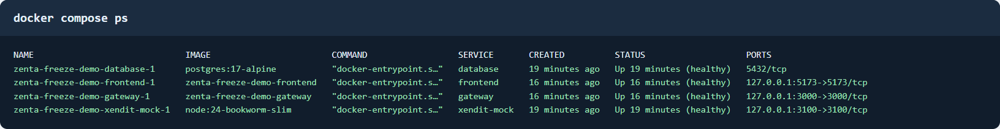
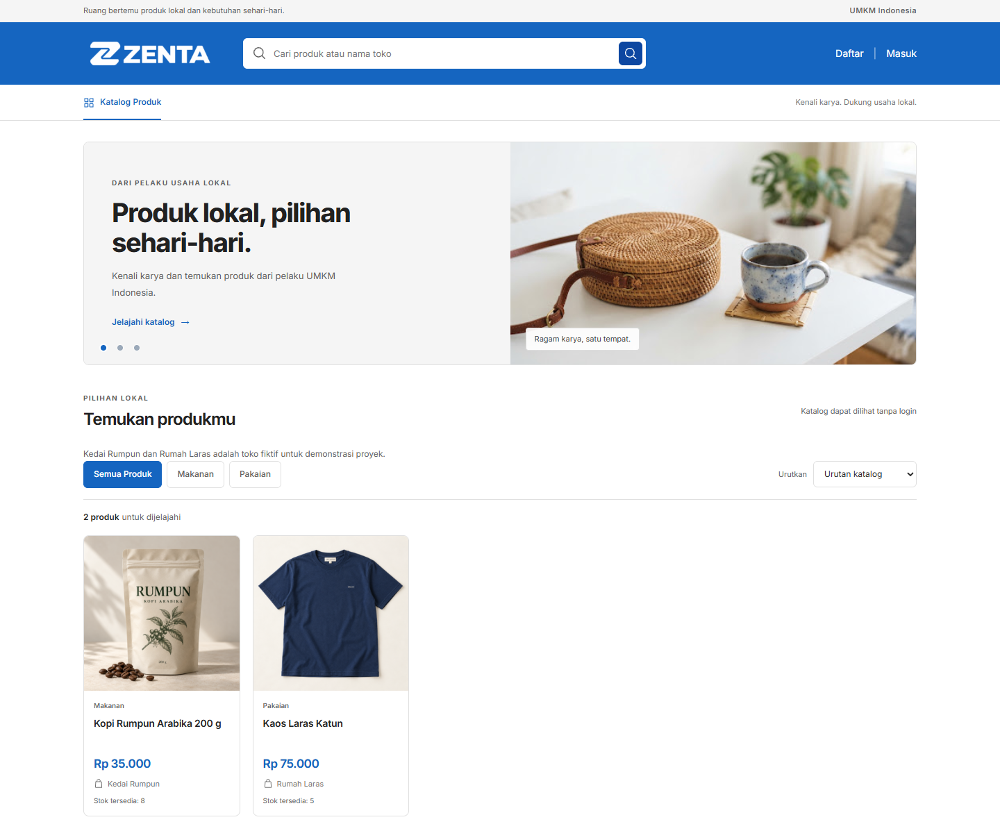
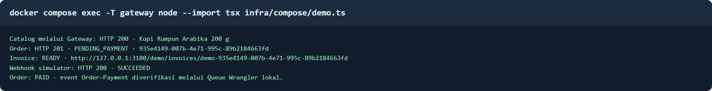

# Penerapan Docker Compose ke Marketplace UMKM Kelompok D

Demo ini memakai salinan lokal dari rilis code freeze proyek Marketplace UMKM Kelompok D. Dockerfile masing-masing membangun Auth, Catalog, Order, dan Payment. Keempat worker berjalan bersama Gateway dalam satu sesi Wrangler agar service binding dan antrean lokal tetap terhubung. Frontend, PostgreSQL demo, dan simulator pembayaran berjalan di container tersendiri. Stack dijalankan dengan `docker compose up --build`.

## Hasil demo lokal

1. **Status Compose.** PostgreSQL, Gateway, frontend, dan simulator pembayaran berstatus `healthy`. Pemeriksaan kesehatan Gateway juga memanggil endpoint kesehatan Auth, Catalog, Order, dan Payment melalui binding lokal.

   

2. **Frontend.** Halaman lokal menampilkan produk yang dibaca dari Catalog melalui API Gateway.

   

3. **Checkout dan pembayaran simulasi.** Checkout melalui Gateway mendapat HTTP `201` dengan status `PENDING_PAYMENT`. Event order menghasilkan invoice `READY`. Callback simulasi mendapat HTTP `200` dengan status pembayaran `SUCCEEDED`, kemudian event pembayaran mengubah status pesanan menjadi `PAID`.

   

Tangkapan frontend diambil dari browser lokal. Tangkapan status dan checkout dirender dari keluaran perintah yang dijalankan pada stack Compose yang sama. Pengujian memakai data demo, identitas uji, dan simulator pembayaran.

## Kode demo

[Docker Compose, Dockerfile, patch, dan petunjuk demo](https://github.com/academicbambang/prakwebservice-lab09-microservices/tree/lab13-bukti-demo-kelompok/docs/lab13/demo-compose-kelompok) tersedia di branch `lab13-bukti-demo-kelompok`. Patch diterapkan pada salinan lokal tag `v1.0-freeze` dari repo proyek Kelompok D.
